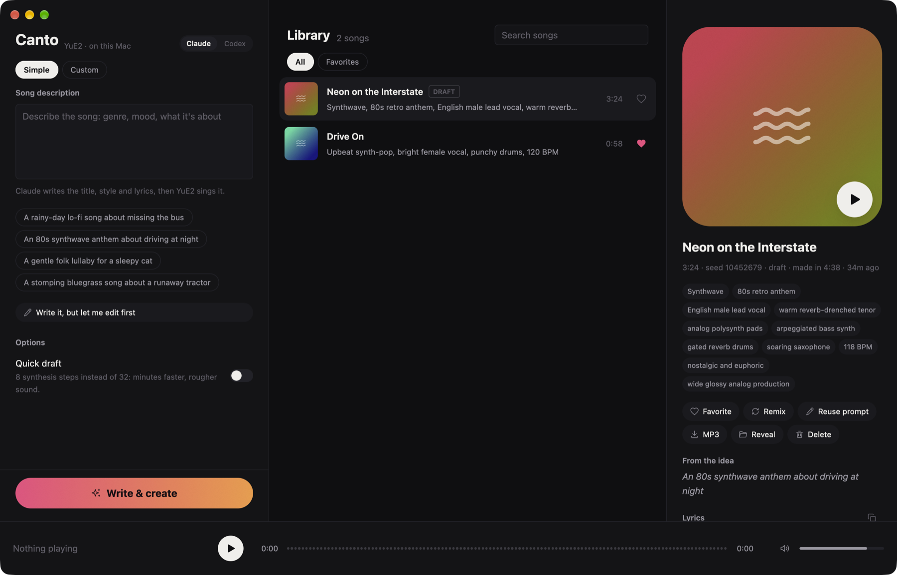

# Canto

A desktop studio for making songs with YuE2 on your own Mac. Describe a song, let Claude or Codex write the title, style and lyrics, and YuE2 sings it locally. Prompt writing runs through the `claude` or `codex` CLI on the subscription you already have, so it costs no API credits.



Canto is a front end for [mlx-Yue](https://github.com/vanch007/mlx-Yue), the MLX port of YuE2, as installed by [YuE2 Studio](https://github.com/stavitian/yue2-studio). It calls the same `mlx-yue` command and reads the songs YuE2 Studio makes.

It has three parts over one core:

- **`canto-core`** (library): the song library, the YuE2 engine adapter, and the refiner adapters.
- **`canto`** (CLI): the scriptable surface for agents and shell use. Every command takes `--json`.
- **`canto-app`** (GPUI app): the desktop app, built with [GPUI](https://gpui.rs) and [GPUI Kit](https://gpui-kit.com).

It was built for fun on an M4 Pro with 64 GB and has only been tested there.

## Requirements

- Apple Silicon Mac with mlx-Yue installed. The easiest route is the YuE2 Studio installer, which puts it at `~/Projects/mlx-Yue`.
- Rust (stable) and Xcode. GPUI compiles Metal shaders at build time, and the Command Line Tools have no Metal compiler. `.cargo/config.toml` points `DEVELOPER_DIR` at `/Applications/Xcode.app`.
- `claude` (Claude Code) and/or `codex` on `PATH`, signed in, for prompt refinement. Generation works without them.
- `ffmpeg`, only for MP3 export.

YuE2's weights are licensed CC-BY-NC-4.0, so the songs are for personal, non-commercial use.

## Install

```bash
make install
```

This builds `~/Applications/Canto.app` and installs the CLI to `~/.local/bin/canto`. `make run` starts a debug build without installing.

## Use the app

- **Simple:** describe the song in a sentence and press **Write & create**. The refiner writes a brief, fills in the Custom form, and queues the song. **Write it, but let me edit first** stops after the writing.
- **Custom:** write or paste lyrics and a style. Each field has a **Refine** button, and **Refine everything** takes an optional direction such as "make the chorus punchier".
- **Quick draft:** runs 8 synthesis steps where a full song runs 32. Writing the song's tokens takes as long either way, but synthesis is about four times faster, and a 3½-minute draft took about 4½ minutes on an M4 Pro.
- **Claude / Codex:** the switch at the top picks the refiner, and Canto remembers it.
- **Library:** double-click a song, or hover its cover, to play it. In the detail panel, **Remix** keeps the prompt with a new seed, and **Reuse prompt** loads the song back into Custom.
- Songs generate one at a time and the rest queue. Cancel one with the ✕ on its row.

## Use the CLI

```bash
canto generate --idea "a folk lullaby for a sleepy cat" --draft
canto generate --title "Night Drive" --style "synthwave, male vocal, 110 BPM" --lyrics-file song.txt
canto generate --title "Radio Interlude" --style "instrumental, jazz, piano" --lyrics "[intro] [instrumental] [outro]" --max-duration-seconds 90 --json
canto refine --idea "a stomping bluegrass song about a runaway tractor" --with codex --json
canto refine --style "rock" --lyrics-file song.txt --only lyrics --instruction "tighter rhymes"
canto list --json
canto show <id>
canto favorite <id>
canto rename <id> "New title"
canto delete <id>
canto export-mp3 <id>
```

`generate --json` streams JSON lines: `refining` and `refined` when a refiner runs, then `started`, `progress` events (`stage`, `fraction`, `detail`), and `done` with the finished song. Errors print `{"error": "..."}` and exit 1.

`generate --max-duration-seconds N` optionally bounds generated audio to 1–360 whole seconds. Omit it to keep the model's existing length behaviour. The model may end earlier; a cap can cut off a musical phrase and does not promise a composed ending. Prompt planning still runs normally. Canto saves the requested limit in `canto.json`, includes it in song JSON, and keeps it in `Song.request()` for remixes. Old songs with no limit remain unbounded by Canto. The desktop Custom form uses the default; remixing a bounded song keeps its limit.

The mlx-Yue adapter alone converts seconds to a semantic token ceiling at 25 codec frames per second and clamps the minimum token count to that ceiling. The current standard decoder produces `1920 × frames − 64` samples at 48 kHz, slightly under the requested ceiling. Allow up to one codec frame (40 ms) of decoder padding when checking audio from a different decoder release. The memory and swap guard, acoustic step count, and other sampling defaults stay unchanged. Details and source verification are in [render length](docs/render-length.md).

## Where things live

| What | Where |
|---|---|
| Config | `~/.config/canto/config.json`, or the path in `CANTO_CONFIG`. A missing file means defaults. |
| Songs | `library_dir`, by default `<yue_project>/outputs/<id>/`, the folder YuE2 Studio uses |
| Canto's notes on a song | `<id>/canto.json`: title, favorite, status, and the original request |
| Engine log | `<id>/canto.log` |
| Deleted songs | `<library_dir>/.trash/` |

Canto shows songs that other tools write into the same folder, and it never edits YuE2's own files.

## Configuration

Every field is optional. The defaults:

```json
{
  "yue_project": "~/Projects/mlx-Yue",
  "library_dir": null,
  "precision": "8bit",
  "memory_budget_gib": 16.0,
  "vae_core_frames": 128,
  "refiner": "claude",
  "refiner_model": null
}
```

`yue_project` also follows `$YUE2_PROJECT`. Leaving `library_dir` as `null` means `<yue_project>/outputs`. `refiner_model` is passed to the refiner CLI's `--model` flag.

## When generation fails

mlx-Yue stops a run when macOS starts swapping, to protect the GPU. Canto reports this as "Not enough free memory" and names the process using the most memory. Free some memory, for example by unloading a local LLM, then press **Remix** or **Reuse prompt**. The engine's full output is in the song's `canto.log`.

## Develop

```bash
make test
make run
```

The seams are adapters. Music models implement `Engine` in `crates/canto-core/src/engine.rs`, and agent CLIs implement `Refiner` in `crates/canto-core/src/refine.rs`. Supporting another model or CLI means writing a new adapter, with no changes to the app.

## Credits

- YuE2 by the YuE team, and the MLX port [mlx-Yue](https://github.com/vanch007/mlx-Yue).
- [YuE2 Studio](https://github.com/stavitian/yue2-studio) for the installer, memory patches, and the reference for driving `mlx-yue`.
- [GPUI](https://github.com/zed-industries/zed) from Zed and [GPUI Kit](https://github.com/longbridge/gpui-kit) from Longbridge.
- Icons from [roc](https://www.npmjs.com/package/@marcusv/roc).

## License

MIT. See [LICENSE](LICENSE).
